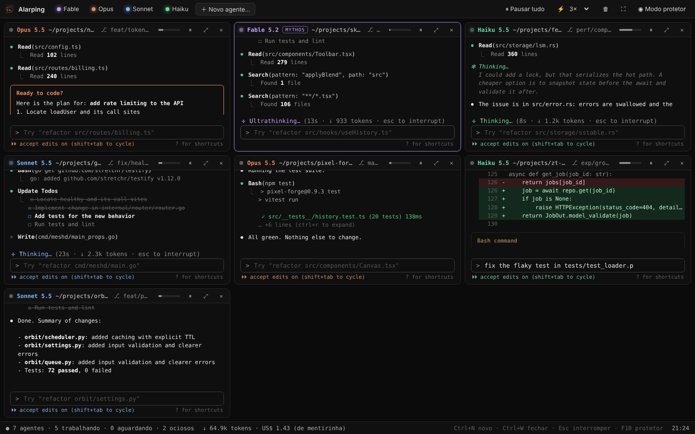

# ✻ Alarping

> **Agent LARP** para Windows. Abra o app, lance quantos "agentes de código" quiser e finja que está orquestrando uma frota inteira.



O Alarping é um protetor de tela de mentirinha que simula vários agentes de código trabalhando ao mesmo tempo: lendo arquivos, editando diffs, rodando testes, fazendo commits e pensando alto. **Nada é real.** Não há chamada de API, não há modelo rodando e nenhum arquivo é alterado. É só diversão.

> Os nomes de modelos (Fable, Opus, Sonnet, Haiku) são usados só para a brincadeira. Este projeto não tem nenhuma relação com a Anthropic.

## Funcionalidades

- **Janelas com cara de terminal de agente:** cabeçalho com modelo, projeto e branch, spinner `✻ Thinking… (12s · ↓ 1.2k tokens · esc to interrupt)` e prompt na base.
- **Ferramentas falsas, mas convincentes:** `Read`, `Search`, `Update` (com diff verde e vermelho), `Bash` (`npm test`, `cargo test`, `pytest`, `go test`…), `Task` (subagentes) e `Web Search`.
- **Lista de tarefas** que vai sendo riscada conforme o agente avança.
- **Raciocínio em itálico** ("Thinking…" / "Ultrathinking…").
- **Pedidos de permissão** com opções `1. Yes` / `2. Yes, and don't ask again` / `3. No`.
- **Plan mode**, com um bloco "Ready to code?" para aprovar o plano.
- **Cinco linguagens** de mentirinha: TypeScript, TSX, Python, Rust e Go.
- **Compactação automática** quando o "contexto" acaba.
- **Interação real com a janela:** digite uma mensagem e o agente muda de tarefa; `Esc` interrompe.
- **Comandos:** `/clear`, `/compact`, `/cost`, `/status`, `/model haiku`.
- **Modo protetor (`F10`):** tela cheia, sem barras, cursor escondido após um tempo e monitor sempre aceso.
- **Múltiplas janelas (multi-monitor):** `Ctrl+Shift+N` ou o botão **🗗 Nova janela** abre outra janela do Alarping, independente da primeira (seu próprio conjunto de agentes). Se houver um segundo monitor livre, a nova janela já abre nele; arraste para onde quiser. A barra de status mostra `⊞ N janelas` quando há mais de uma aberta.

## Modelos (de mentirinha)

| Modelo | Personalidade |
|---|---|
| **Fable 5.2** | Lento e profundo. Faz "Ultrathinking" e dispara vários subagentes. |
| **Opus 5.5** | O veterano. Pensa bastante e às vezes usa subagentes. |
| **Sonnet 5.5** | Equilibrado. |
| **Haiku 5.5** | Rápido demais. Dispara ferramentas sem parar. |

## Atalhos

| Atalho | Ação |
|---|---|
| `Ctrl+N` | Novo agente (projeto, primeira tarefa, modo, quantidade) |
| `Ctrl+1` a `Ctrl+4` | Lança Fable, Opus, Sonnet ou Haiku na hora |
| `Ctrl+Shift+N` | Abre outra janela do app (outro monitor) |
| `Ctrl+W` | Fecha o agente focado |
| `Tab` / `Shift+Tab` | Troca o foco entre janelas / alterna o modo (`accept edits`, `plan`, `default`) |
| `Espaço` | Pausa ou retoma todos |
| `Esc` | Interrompe o agente focado (ou sai do modo protetor) |
| Duplo clique no cabeçalho | Maximiza ou restaura a janela |
| `F10` | Modo protetor |
| `F11` | Tela cheia |

## Rodar a partir do código

Você precisa de Node.js LTS (testado com a v22).

```bash
npm install
npx electron .
```

## Gerar o `.exe` para Windows

```bash
node build/build.js
```

O resultado sai em `dist/Alarping-win32-x64/`, com o `Alarping.exe` e o ícone já embutido. O app não é assinado, então o SmartScreen pode avisar na primeira execução: clique em **Mais informações → Executar assim mesmo**.

## Estrutura

```
main.js            processo principal do Electron (janela, tela cheia, sem suspensão)
preload.js         ponte segura entre a janela e o processo principal
app/
  index.html       layout (barra superior, grade, barra de status, modal)
  styles.css       visual de terminal
  scenarios.js     projetos, linguagens, diffs e frases falsas
  app.js           "runtime" dos agentes: spinner, ferramentas, permissões, loop
build/
  build.js         empacota com @electron/packager e embute o ícone e a versão
  icon.py          gera o ícone (assets/icon.ico)
```

## Licença

MIT. Use, copie, faça LARP à vontade.
